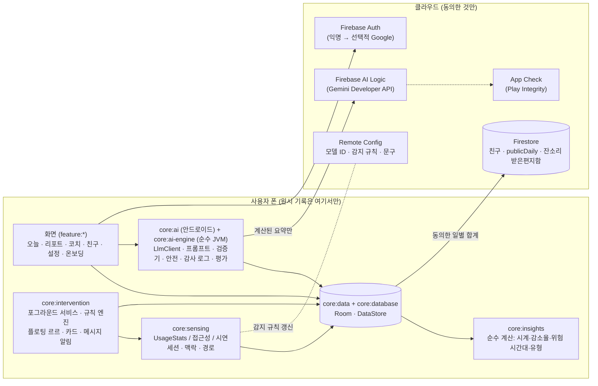
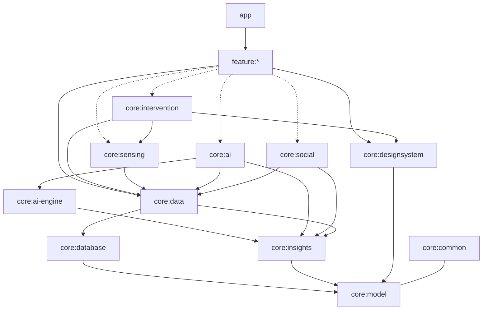
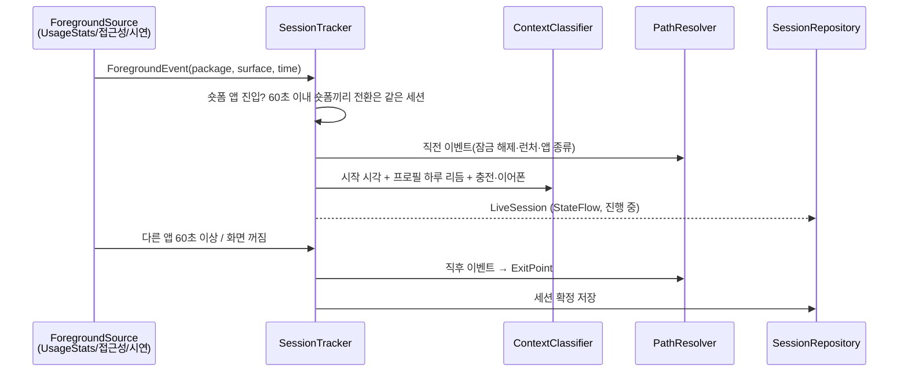
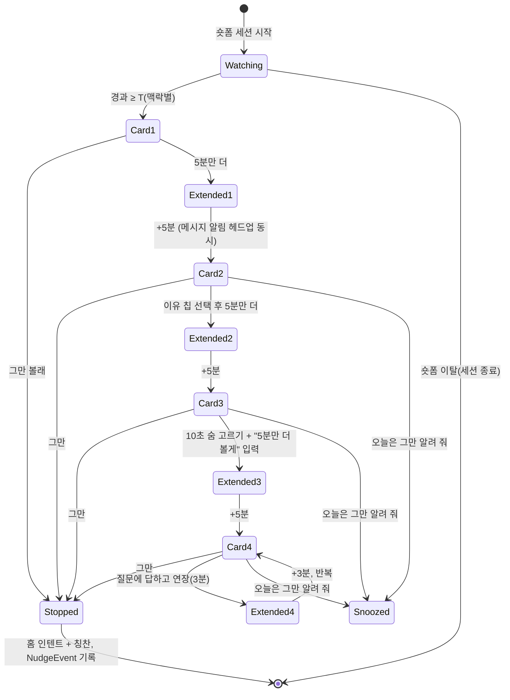
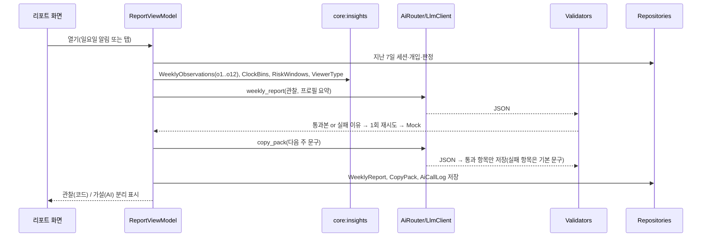

# 03. 시스템 아키텍처

> 담당: R1 · 모듈 경계·의존 방향·버전 표는 계약이다. 바꾸려면 ADR.

## 1. 큰 그림

- 원시 이벤트·세션·채팅은 기기 밖으로 나가지 않는다. 클라우드로 가는 것은 (1) AI 호출 시 `core:insights`가 만든 요약, (2) 친구 기능 동의 시 일별 합계(감소율·기록률), (3) 친구에게 맡긴 잔소리.
- `core:intervention` → `core:ai` 의존이 **없다**(ADR-0001). 개입 순간의 문구는 미리 저장해 둔 문구 팩에서 고른다.

## 2. 모듈 의존 그래프

점선은 일부 feature만 쓰는 의존(AGENTS.md 4절 표가 정답). `core:model`, `core:common`, `core:insights`, `core:ai-engine`은 **순수 Kotlin/JVM 모듈**(안드로이드 의존 금지) → 단위 테스트·AI 평가가 에뮬레이터 없이 돌고, AI 에이전트가 고치기 쉽다.

## 3. 실행 흐름

### 3.1 감지 → 세션 → 맥락·경로

- `ForegroundSource`(ADR-0004): `UsageStatsSource`는 화면이 켜져 있을 때만 짧은 주기로 `queryEvents`를 조회한다(화면 꺼지면 즉시 멈춤). `AccessibilitySource`는 창 전환 이벤트로 즉시 판단하고, 숏폼 화면 판별 규칙(`assets/surface_rules.json`)과 넘김·클릭 횟수를 더한다. `DemoEventSource`는 시나리오 재생(1초 = 1분 배속 가능).
- 앱 이름·종류: 런처 앱을 `<queries>`(MAIN/LAUNCHER intent)로 보이게 하고 `ApplicationInfo.category` + `assets/app_kinds.json`(카카오톡=MESSENGER, 에브리타임=SOCIAL 등 큐레이션)으로 `AppKind`를 정한다. `QUERY_ALL_PACKAGES`는 쓰지 않는다.

### 3.2 개입 사다리 (PRD 7.2)

- `NudgeEngine`은 순수 상태 기계(`core:intervention`, 시계 주입) → 단위 테스트로 모든 전이를 검증한다.
- 하루 연장 3회 초과 시 다음 세션은 `Card2`에서 시작. 스누즈는 그날의 하루 경계(새벽 4시)까지.
- 문구는 `CopyPackRepository`(주간 리포트 때 AI가 만든 것, 없으면 기본 팩)에서 맥락·단계(`L1`~`L4Question`)·말투로 고른다. 자리표시자는 코드가 채운다. 기본 팩과 전략 목록 파일은 `core/data/src/main/assets/`에 있고, 순수 JVM인 `core:ai-engine`에는 인자로 넘긴다(05 문서 8절).

### 3.3 주간 리포트 생성 (앱이 화면에 있을 때만)


### 3.4 코치 채팅 (도구 호출 루프)
`CoachEngine`이 최대 3회 도구 호출 → 결과를 대화에 붙여 다시 호출 → 최종 JSON 답 → 검증(근거 ID·숫자 일치) → 표시. 도구는 모두 읽기 전용(05 문서 5.4). '계획으로 저장'은 사용자가 버튼을 눌러야 저장된다.

## 4. 주요 컴포넌트
| 컴포넌트 | 모듈 | 요점 |
|---|---|---|
| `MonitorService` | intervention | 포그라운드 서비스(상시 알림 1개, 채널 `service_status` 낮은 중요도). 화면 켜짐/꺼짐 수신, 감지 소스 시작·정지, `NudgeEngine` 구동 |
| `OverlayController` | intervention | `WindowManager` + `TYPE_APPLICATION_OVERLAY`. `ComposeView`에 `LifecycleOwner`·`SavedStateRegistryOwner`·`ViewModelStoreOwner`를 직접 붙인다(서비스에는 없음). 플로팅 버블은 `wrap_content` + `FLAG_NOT_FOCUSABLE`, 끌기·가장자리 붙기. 카드는 포커스 가능 창 |
| `PauseNotifier` | intervention | 채널: `buddy_message`(높음, 헤드업), `reminder`(기본), `friends`(기본), `service_status`(낮음). 메시지 알림은 `MessagingStyle` + `Person`("르르 · 사르르" / "민지 · 맡겨 둔 잔소리"), 대화 단축키 없음(ADR-0003), 탭 → 코치 채팅 딥링크 |
| `ReminderScheduler` | intervention | WorkManager: 예약 알림(하루 최대 3), 위험 시간대 미리 알림(하루 최대 1), 일요일 리포트 알림, 보관 기간 정리 |
| `SessionTracker` | sensing | 상태 기계, 세션 병합 규칙, `LiveSession` StateFlow |
| `ContextClassifier` | sensing | PRD 8절 우선순위 규칙 + 확신도. 순수 함수 + 기기 신호 어댑터 |
| `PathResolver` | sensing | 진입(잠금 해제 10초·런처·앱 종류·다른 숏폼)·이탈(화면 끔 10초·홈·앱 종류·'그만' 뒤 60초) |
| `DemoScenario` | sensing | 고정 시드 14일 × 3패턴, 가상 친구·코호트 |
| `ClockBins`, `Baseline`, `ReductionRate`, `Coverage`, `RiskWindows`, `ViewerTypeClassifier`, `WeeklyObservations` | insights | 순수 계산 + 테스트 |
| `LlmClient`, `MockLlmClient`, `RestGeminiClient`(평가 전용), `PromptRegistry`, `*Validator`, `SafetyFilter`, `CoachEngine`, `eval/` | ai-engine | 순수 JVM, 05 문서 |
| `AiRouter`, `CloudLlmClient`, `OnDeviceLlmClient`, `AiCallLogger`, `WeeklyReportGenerator`, `CopyPackGenerator`, `PokeDrafter` | ai | 안드로이드, 05 문서 |
| `FriendRepository`, `PokeInbox`, `LeagueRepository` | social | Firestore, 오프라인이면 가상 친구 |

## 5. 권한·매니페스트 (각 모듈 Manifest에 선언, 앱 Manifest는 병합만)
| 권한 / 선언 | 모듈 | 왜 | 비고 |
|---|---|---|---|
| `PACKAGE_USAGE_STATS` (특별 접근) | sensing | 앱 전환 기록 | 설정 화면으로 이동해 사용자가 켬. `tools:ignore="ProtectedPermissions"` |
| `FOREGROUND_SERVICE` + `FOREGROUND_SERVICE_SPECIAL_USE` | intervention | 사용자가 켠 동안 감지 | 유형 `specialUse` 하나 + `PROPERTY_SPECIAL_USE_FGS_SUBTYPE`. Play Console 선언·동영상 필요 |
| `POST_NOTIFICATIONS` (13+) | intervention | 메시지 알림·예약 알림 | 런타임 요청 |
| `SYSTEM_ALERT_WINDOW` (특별 접근) | intervention | 플로팅 르르·카드 | 거절 시 알림으로 대체 |
| `BIND_ACCESSIBILITY_SERVICE` (서비스 선언) | sensing | 정밀 모드(선택) | `isAccessibilityTool` 선언 금지. 앱 안 고지 필수 |
| `RECEIVE_BOOT_COMPLETED` | intervention | 재부팅 후 알림 예약 복구, 감지를 켜 둔 경우 서비스 재시작 | `specialUse`는 부팅 시작 금지 목록에 없음(Android 15) |
| `<queries>` 추적 앱 7개 `<package>` + MAIN/LAUNCHER | sensing | 추적 앱 확인, 앱 이름·종류 표시 | `QUERY_ALL_PACKAGES` 금지 |
| (P1) `QUERY_ADVANCED_PROTECTION_MODE` | sensing | Android 17 고급 보호 모드면 정밀 모드 끄기 | 정밀 모드를 넣을 때만 |
| `INTERNET` | ai, social | Firebase | — |
| (P2) `ACTIVITY_RECOGNITION` | sensing | 이동 맥락 정확도 | MVP 제외 |

정책 메모(`docs/02_RESEARCH.md` 4절): 포그라운드 서비스는 `specialUse` 하나·사용자가 화면에서 켤 때만 시작, 정확한 알람 미사용, 배터리 최적화 예외는 직접 요청하지 않고 설정 화면 안내만, 사용 기록·접근성은 앱 안 고지 + Play Console 선언, AI 출력 신고 버튼, 만 18세 이상.

## 6. 버전 표 (여기 적힌 값만 쓴다)
> `gradle/libs.versions.toml`은 이 표에서 만든다. 에이전트는 버전을 올리지 않는다. 표를 바꾸려면 R1이 ADR-0007을 갱신한다.

확인일 2026-11-05(공식 릴리스 노트·Maven Central·Play Console 도움말). 출처는 `docs/02_RESEARCH.md` 6절.

| 묶음 | 항목 | 버전 | 메모 |
|---|---|---|---|
| 도구 | Android Studio | Rabbit 2 (2026.2.2) | 안정판 |
| 도구 | AGP | 9.5.0 | **내장 Kotlin**(kotlin-android 플러그인 적용 금지), kapt 불가 |
| 도구 | Gradle wrapper | 9.8.2 (최소 9.6.0) | |
| 도구 | JDK | Gradle 실행 21, 바이트코드 17 | Robolectric이 SDK 36+에서 JDK 21 요구 |
| SDK | minSdk / targetSdk / compileSdk | 29 / 36 / 37 | targetSdk 36 = 2026-08-31부터 Play 최소값 |
| Kotlin | kotlin (jvm·compose·serialization 플러그인) | 2.4.21 | Compose 컴파일러 플러그인 = Kotlin 버전 |
| Kotlin | KSP | 2.3.13 | 2.3.x부터 Kotlin과 따로 번호를 매김 |
| Kotlin | kotlinx-coroutines | 1.11.0 | core·android·test |
| Kotlin | kotlinx-serialization-json | 1.12.0 | |
| Compose | compose-bom | 2026.09.00 | ui 1.12.1, material3 1.4.0 |
| AndroidX | activity-compose | 1.13.0 | |
| AndroidX | lifecycle (runtime-compose, viewmodel-compose) | 2.11.0 | |
| AndroidX | core-ktx / core-splashscreen | 1.19.1 / 1.2.0 | |
| AndroidX | navigation3 (runtime, ui) | 1.2.1 | `lifecycle-viewmodel-navigation3` 2.11.0 |
| AndroidX | room (runtime, ktx, compiler, testing) | 2.8.5 | Room 3(3.0.3)은 쓰지 않음 |
| AndroidX | datastore-preferences | 1.3.0 | |
| AndroidX | work-runtime | 2.12.0 | `-ktx`는 빈 모듈 |
| DI | hilt-android / hilt-compiler / 플러그인 | 2.60.1 | KSP 안정 지원 |
| DI | androidx.hilt (lifecycle-viewmodel-compose, work, compiler) | 1.4.0 | `hiltViewModel()`은 `hilt-lifecycle-viewmodel-compose` |
| Firebase | firebase-bom | 35.1.0 | `firebase-ai` 18.1.0, App Check 20.0.0 |
| Firebase | google-services 플러그인 | 4.5.0 | `google-services.json`이 있을 때만 적용 |
| AI | ML Kit `genai-prompt` (선택) | 1.0.0-beta5 | 베타, 앱이 화면에 있을 때만 |
| 테스트 | junit / turbine / robolectric | 4.13.2 / 1.2.1 / 4.17 | |
| 테스트 | androidx.test ext-junit / espresso / core·runner·rules | 1.3.0 / 3.7.0 / 1.7.0 | |
| 품질 | Spotless / ktlint | 8.11.0 / 1.8.0 | `ktlint("1.8.0")` |
| CI | checkout / setup-java / setup-gradle / upload-artifact | v7 / v6 / v6 / v7 | |

## 7. 폴더 구조
```
.
├── AGENTS.md  CLAUDE.md  GEMINI.md  ONE_SHOT_PROMPT.md  KIT_GUIDE.md
├── app/
├── build-logic/convention/          # pause.android.application / pause.android.library / pause.android.library.compose / pause.android.feature / pause.android.hilt / pause.jvm.library
├── core/{model,common,testing,database,data,sensing,insights,intervention,ai-engine,ai,social,designsystem}/
│   └── <모듈>/AGENTS.md             # 10줄: 역할·하는 일·공개 API·의존 가능·금지
├── feature/{onboarding,today,report,coach,friends,settings}/
├── core/ai-engine/src/main/resources/prompts/ # weekly_report_v1.md …
├── core/ai-engine/src/test/resources/eval/    # 평가 데이터
├── core/sensing/src/main/assets/    # app_kinds.json, surface_rules.json, demo/
├── core/designsystem/src/main/res/font/  # Pretendard(pause_sans_variable.ttf)
├── core/designsystem/src/main/res/drawable-nodpi/  # designsystem_buddy_body.webp (+ melt_1~3)
├── core/data/src/main/assets/       # copy/default_pack.json, strategies.json
├── firebase/                        # firestore.rules, (P1) functions/
├── docs/ …
└── .github/ …
```

## 8. 테스트 전략
| 대상 | 방법 |
|---|---|
| `core:insights`, `core:model`, `NudgeEngine`, `ContextClassifier`, `PathResolver`, 검증기 | JVM 단위 테스트(JUnit4 + `kotlin.test` 단언, 가짜 Clock. 단언 라이브러리를 추가하지 않는다). 경계값 표 기반 |
| `SessionTracker` | 이벤트 시퀀스 → 기대 세션 목록(시나리오 테스트) |
| Room | 마이그레이션 테스트, DAO 테스트(Robolectric 또는 계측) |
| 화면 | 상태별 `@Preview`(라이트·다크) + 핵심 화면 Compose UI 테스트(오늘, 카드, 채팅) |
| 시연 | `DemoScenario` 결정성 테스트(같은 시드 = 같은 세션) |
| AI | `:core:ai-engine:aiEval`(05 문서 9절), 모의 제공자는 CI에서 항상 |
| CI | `./gradlew spotlessCheck check assembleDebug` + `./gradlew :core:ai-engine:aiEval -Pprovider=mock` |

## 9. 성능·배터리
- 감지 폴링은 **화면이 켜져 있고** 사용 기록 권한이 있을 때만. 추적 앱이 앞에 없으면 주기를 늘린다(예: 숏폼 중 2초, 그 외 5초 — 실기기에서 조정).
- 오버레이는 숏폼 세션 중에만 붙인다. 세션이 끝나면 창을 제거한다.
- AI 호출은 포그라운드에서만, 주 1회 리포트 + 채팅. 일일 상한(05 문서 2절).
- 제조사 백그라운드 제한(특히 삼성): 온보딩 마지막에 "앱 절전 예외" 설정 화면 안내(직접 예외 요청 X).
